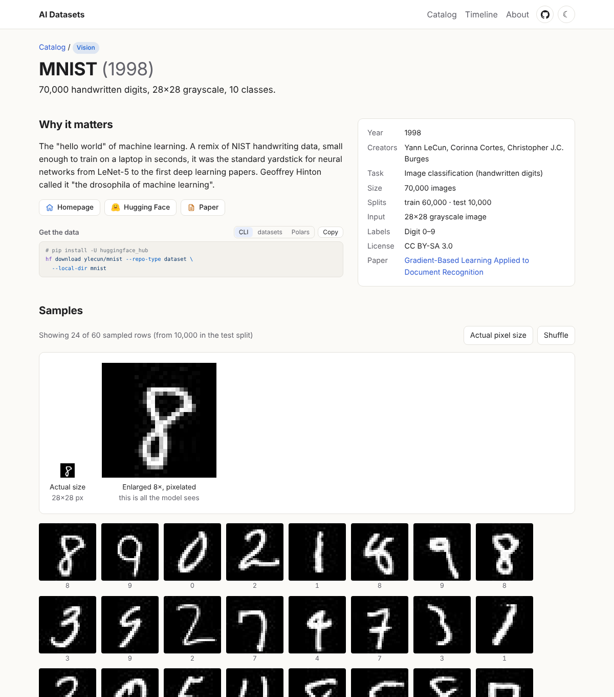

# AI Datasets

[](https://mralbu.github.io/ai-datasets/)
[](https://github.com/mralbu/ai-datasets/actions/workflows/deploy.yml)

A small static site showing what classic AI datasets and benchmarks actually look like:
why each one mattered, the key facts, real samples, and a copy-paste snippet to download it.

**→ [mralbu.github.io/ai-datasets](https://mralbu.github.io/ai-datasets/)**

[](https://mralbu.github.io/ai-datasets/d/mnist)

Not a catalog; Hugging Face already does that. The goal is a few dozen historically important
datasets across vision, LLMs, text, tabular data and audio, each shown well enough that you come
away knowing the data.

## How it works

```
datasets/<id>.yaml      one file per dataset: facts, description, Hugging Face source, how to display it
scripts/sample.py       (uv: polars, altair, pillow) samples rows from the Hugging Face dataset viewer
                        into a snapshot, then copies it to src/generated/ and public/samples/
src/                    Astro site: catalog, timeline, one page per dataset, search (press /)
samples branch          the snapshot: sampled rows, media and a manifest (generated, data only)
justfile                shortcuts for everything below (run `just` to list them)
```

### Where samples come from

Samples are fetched once and kept on the **`samples` branch**, an orphan branch that holds only
data. Each dataset has a fingerprint (its `source` block and chart config). On every deploy the
workflow checks out `samples` into `.samples/`, re-fetches only datasets that are new or whose
fingerprint changed, prunes removed ones, commits the snapshot back to `samples`, and builds.
A normal push touches Hugging Face not at all.

- `--strict` in CI: if a fetch fails, the build fails and Pages keeps serving the last good site.
  The previous sample of that dataset is kept in the snapshot.
- `manifest.json` on the branch records, per dataset, the Hugging Face revision and fetch time;
  each page shows it under the samples.
- To re-fetch on purpose: `just deploy-refetch <ids>` (or `all`), which runs the deploy workflow
  with `refetch` set; or bump `SAMPLER_VERSION` in `scripts/sample.py`.
- Taking a sample down: delete or edit it on the `samples` branch (squash or recreate the branch
  if it must leave history); nothing on `main` needs rewriting.
- A monthly workflow (`check-sources.yml`) makes one tiny request per source and fails if a
  dataset was renamed, gated or deleted upstream. Run the same check locally with `just check`.

## Develop

Needs Node 22+, [uv](https://docs.astral.sh/uv/) and, for the shortcuts, [just](https://just.systems/).

```sh
just setup     # npm install, and the published snapshot checked out in .samples/
just fetch     # sample whatever is new or changed (nothing, right after setup)
just dev       # http://localhost:4321
```

| command | does |
|---|---|
| `just fetch [ids…]` | sample datasets that are new or changed (all, or only the given ids) |
| `just refetch ids…` | re-sample the given ids even if unchanged |
| `just check` | check that every Hugging Face source still serves rows |
| `just dev` | dev server at the site root |
| `just build` / `just preview` | build at the site root (as `dev` does), and serve it locally |
| `just new <id> <like>` | start `datasets/<id>.yaml` from an existing entry |
| `just deploy-refetch ids…` | run the deploy workflow on GitHub with forced re-fetches (needs `gh`) |
| `just clean` | remove build output and caches (keeps `.samples/`) |

Without just, the same commands are `npm install`, `uv run scripts/sample.py [--force|--check] [ids…]`
and `BASE_PATH=/ npm run dev`. Without the `samples` worktree, `.samples/` is just a local cache and
the first fetch fills it, which takes 10 minutes or more for the whole catalog.

## Add a dataset

1. `just new <id> <similar-id>` and fill it in. `modality` is the category (`vision`, `text`,
   `benchmark` (shown as "LLMs"), `tabular`, `audio`, `other`). `display.kind` picks the renderer;
   field names are columns of the Hugging Face dataset:

   | kind | fields | used by |
   |---|---|---|
   | `image` | `image`, `label`, `scale` (enlarge tiny images), `thumb` (px height for photos), `class_grid`, `short_labels` | MNIST, Fashion-MNIST, CIFAR-10, SVHN, ImageNet |
   | `boxes` | `image`, `objects` (COCO-style `bbox` `[x, y, w, h]` + a label list), `label` (its name, default `label`), `names` (when labels are plain integers), `ignore` (classes drawn as dashed "don't care" regions) | COCO, PASCAL VOC, KITTI |
   | `segmentation` | `image`, `objects` (ADE20K-style: `name`, `polygon {x, y}`, `depth_ordering_rank`, `parts.part_level`), `scene` | ADE20K |
   | `dense` | `image`, `layers` (each a `field`, `type` (`labels`, `depth` or `normals`), `name`, and for labels `classes: [{id, name, color}]`); needs `source.dense` | Cityscapes, NYU Depth V2 |
   | `annotated` | `image`, `captions` (list) or `attributes: true` (yes/no columns), `thumb` | Flickr30k, CelebA |
   | `text` | `text`, `label`, `summary` (shown on demand), `caption` (small line, e.g. a URL) | IMDB, 20 Newsgroups, WikiText-103, CNN/DailyMail, C4 |
   | `record` | `label`; shows every text field, per config | GLUE, SuperGLUE, SNLI |
   | `extractive` | `context`, `question`, `answers`, `title` | SQuAD |
   | `translation` | `translation` (a Translation feature), `source`, `target` (language codes) | WMT14 |
   | `qa` | `question`, `answer`, `tags` (fields shown as tags), `math` (LaTeX via KaTeX), `input`, `wrong` (list of false answers), `answer_label` | GSM8K, MATH, TruthfulQA, Alpaca |
   | `mcq` | `question`, `choices` (a list, or `{text, label}`), `answer` (index or key), `subject` | MMLU, HellaSwag, AI2 ARC |
   | `image_mcq` | `images` (list of image columns), `question`, `options`, `answer` (letter), `subject` | MMMU |
   | `code` | `prompt`, `solution`, `tests`, `title`; `*_lang` (Shiki language, `text` for prose) and `*_label` | HumanEval, SWE-bench |
   | `preference` | `chosen`, `rejected` (Human:/Assistant: transcripts) | Anthropic HH-RLHF |
   | `grid` | `train`, `test` (ARC-style pairs of integer grids) | ARC-AGI |
   | `audio` | `audio`, `text` and/or `label` (a class or a list of classes), `speaker` | LibriSpeech, AudioSet, Speech Commands, LJSpeech |
   | `table` | `columns` (default: all); `chart: {type: scatter \| rate, x, y, color}` | Iris, Titanic, Palmer Penguins, MovieLens |

   Useful `source` options:
   - `n` (rows to sample) and `seed`.
   - `configs: [...]` samples several configs, like GLUE's tasks or MMMU's subjects.
   - `fetch_all: true` reads a small table whole (needed for charts).
   - `rows_per_page` (default 8): lower it when the split is sorted by a label with many values,
     as ImageNet's is.
   - `min_length: {field: n}` skips rows whose field is shorter, like WikiText's blank lines.
   - `drop: [columns]` leaves columns out of the sample.
   - `max_image_px` downscales big photos; annotations keep their original coordinates.
   - `dense: {column: image | labels | depth | normals}` turns per-pixel annotations (mask images or
     raw arrays) into small PNGs the `dense` view colors and reads back on hover.
   - `page` (default 100) is the number of rows per request; set it to 1 when rows are megabytes each,
     like NYU's raw arrays.

   The "Get the data" box shows snippets for the `hf` CLI, 🤗 `datasets` and Polars, built from
   `source`. Override it with an optional `download` block: `hf` (the canonical repo, when the sample
   comes from a mirror), `config`, `split`, `include` (glob for `hf download --include`, for one config
   of a big repo), `revision`, `gated: true` and `note`.
2. `just fetch <id>` and check the page with `just dev`. Look at the sampled rows before publishing:
   some datasets contain offensive material, and a different `seed` picks other rows.
3. Related datasets (`lineage`) take `hf: <owner/name>` to link to Hugging Face, or `url:` when
   there is no HF copy, and `id:` when the dataset also has a page on this site. Link back from the
   related entries too.

The schema lives in `src/content.config.ts`; the build fails on a malformed entry.

Gotchas:
- Some Hugging Face repos are not readable by the dataset viewer (loading scripts, odd layouts).
  Search for a community Parquet copy with a working viewer and say so in `download.note`.
- The viewer's signed media links fail for config names containing `+`; use another copy.
- Gated datasets (GPQA, Humanity's Last Exam) cannot be sampled. Link them from `lineage` instead.

## Deploy

`.github/workflows/deploy.yml` updates the snapshot, builds, and publishes to GitHub Pages on every
push to `main`. In the repo settings, set **Pages → Source** to **GitHub Actions**.
